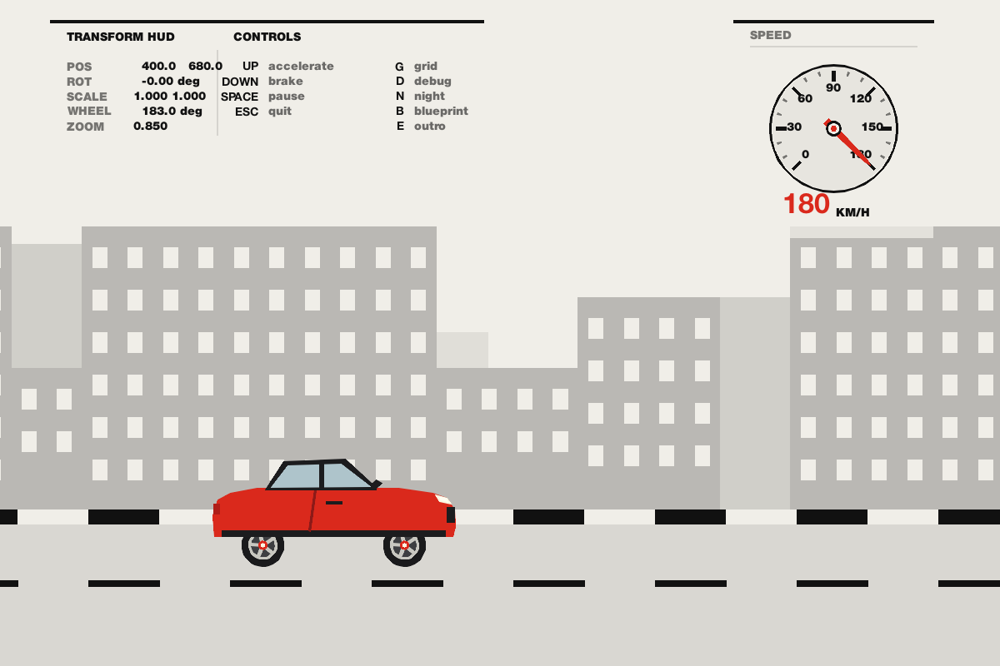
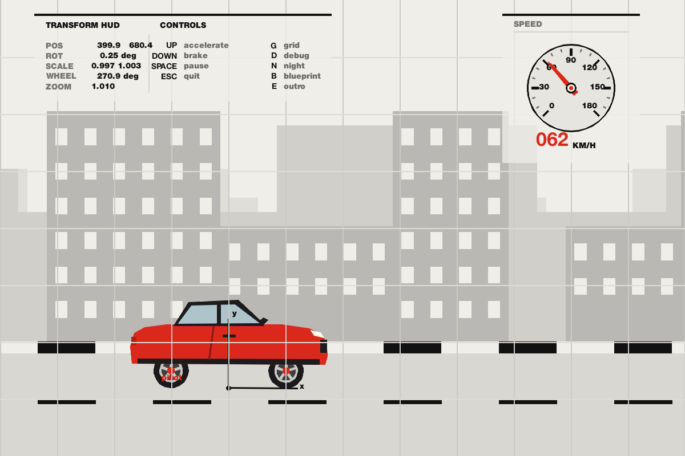
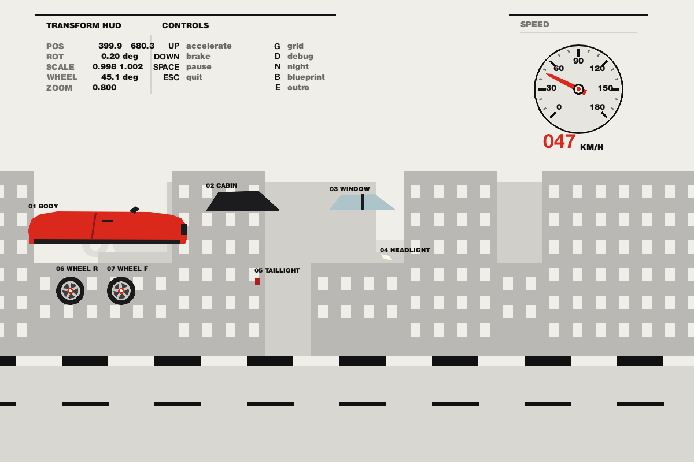
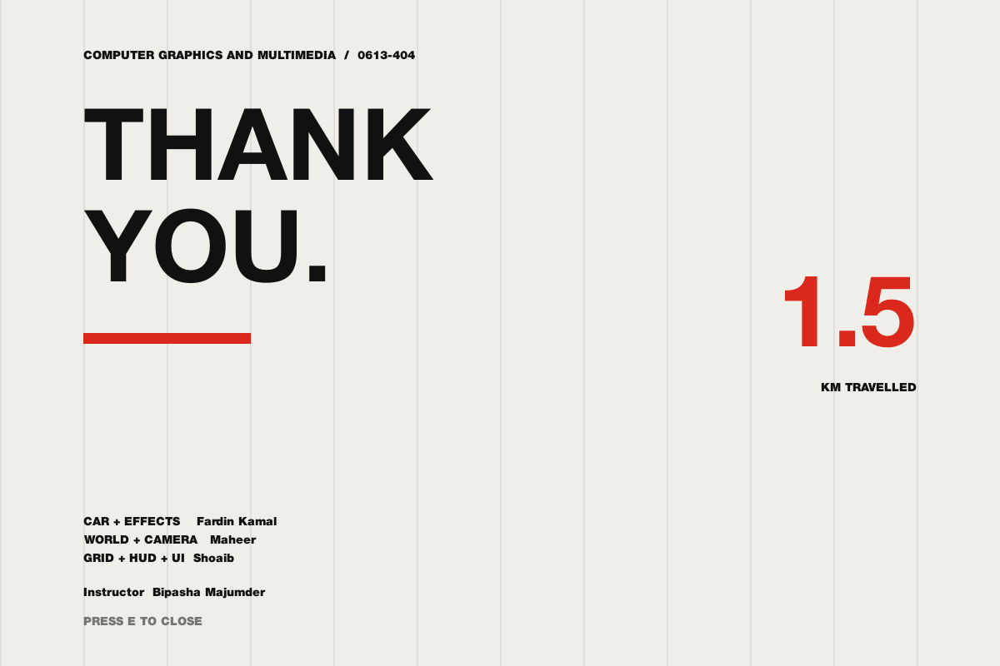

# Grid in Motion: Car Moving on a Road

A 2D computer graphics animation built with **Python + pygame**. The project started as a C++/OpenGL (FreeGLUT) design; the current implementation follows the same design plan in Python.

A car drives through an endless world built on a strict layout grid. The road dashes, buildings, typography and UI all align to it. Every transformation is computed with our own 3×3 homogeneous matrices, not pygame's built-in drawing transforms. pygame is used only to open the window, fill polygons and draw text.

| | |
|---|---|
| **Course** | Computer Graphics and Multimedia, 0613-404 |
| **Instructor** | Bipasha Majumder |
| **University** | Dhaka International University |
| **Team** | Fardin Kamal [fardinkamal62@gmail.com](mailto:fardinkamal62@gmail.com) · Maheer [maheer.mahibi@gmail.com](mailto:maheer.mahibi@gmail.com) · Shoaib [mdsiamulislamsoaib@gmail.com](mailto:mdsiamulislamsoaib@gmail.com) |

---

## Table of Contents
1. [Concept](#concept)
2. [Design Rules](#design-rules)
3. [2D Transformations Used](#2d-transformations-used)
4. [Matrix Math](#matrix-math)
5. [Features](#features)
6. [Controls](#controls)
7. [Project Structure](#project-structure)
8. [Run](#run)
9. [Windows Executable](#windows-executable)
10. [Testing Without a Window](#testing-without-a-window)
11. [Screenshots](#screenshots)
12. [Team Contributions](#team-contributions)
13. [Git Workflow](#git-workflow)
14. [References](#references)

---

## Concept

The camera is a **side view**, like a 2D racing game. The car stays at a fixed point on the screen, about one third from the left, and the world scrolls past it.

A live **HUD** shows the car's transformation values in real time, so the math is visible while the animation runs.

## Design Rules

1. **Palette:** paper (off-white), ink (near-black), and one accent, red. Grays are only mixes of ink and paper.
2. **Flat only:** no gradients, shadows, outlines or textures.
3. **Primitives only:** rectangles, circles, polygons and straight lines.
4. **One typeface family**, a few sizes: big numerals for impact, small labels for information.
5. **Layout grid:** 100 px units on a 1200 × 800 screen; objects align to it.
6. **Asymmetry and whitespace:** left-aligned text, off-center composition, intentional empty space.
7. **Red is reserved for:** the car body, taillights, speedometer needle and key numerals.
8. **Day/night mode** swaps ink and paper. Red stays the same.

## 2D Transformations Used

| Transformation | Where it appears |
|---|---|
| **Translation** | Car position, scrolling road dashes, parallax layers, poster slide |
| **Rotation** | Wheel spin, body tilt on acceleration/braking (pivot at rear axle), speedometer needle and ticks |
| **Scaling** | Squash and stretch, parallax depth, camera zoom |
| **Combination** | Pivot rotation, wheels as children of the body (matrix stack), camera × object transforms |

The composition used throughout the scene is:

```
M = C · T · R(pivot) · S
```

where `C` is the camera matrix and the rest are the object's local transforms.

## Matrix Math

Points are column vectors `[x y 1]ᵀ`. All transforms are 3×3 homogeneous matrices.

```
Translation T(tx, ty)      Rotation R(θ)              Scaling S(sx, sy)
| 1  0  tx |               | cosθ  -sinθ  0 |         | sx  0   0 |
| 0  1  ty |               | sinθ   cosθ  0 |         | 0   sy  0 |
| 0  0  1  |               |  0      0    1 |         | 0   0   1 |
```

**Rotation about a pivot (px, py):**

```
M = T(px, py) · R(θ) · T(-px, -py)
```

**Wheel rotation angle** (rolling without slipping):

```
angle = distance travelled / wheel radius
```

**Hierarchy:** child transform = parent matrix × local matrix, handled with a push/pop matrix stack. Moving the body automatically moves the wheels.

## Features

**Car**
- Body, cabin and windows drawn as polygons, with lights, mirror and trim
- Alloy wheels as children of the body, spinning at the correct speed
- Body tilt (pivot at rear axle), squash and stretch
- Blueprint explode mode (parts fly apart and reassemble)
- Brake lights

**World**
- Infinite looping road with evenly spaced lane dashes and curbs
- Three parallax layers (far, mid, near) with different speeds and scales
- Smooth camera zoom (out at high speed, in when slow)

**UI and Design**
- Toggleable alignment grid overlay
- Speedometer with rotating needle and tick marks
- Live transformation HUD (position, rotation, scale, wheel angle, zoom)
- Debug mode showing pivots and coordinate axes
- Poster-style intro and closing outro
- Day/night mode

## Controls

| Key | Action |
|---|---|
| `↑` | Accelerate |
| `↓` | Brake |
| `G` | Toggle alignment grid overlay |
| `D` | Toggle debug mode (pivots and axes) |
| `N` | Toggle day/night |
| `B` | Blueprint explode / reassemble |
| `E` | Show outro (press again to close) |
| `Enter` | Skip intro |
| `Space` | Pause |
| `Esc` | Quit |

## Project Structure

```
.
├── README.md
├── requirements.txt
├── main.py          game loop, input, integration
├── mat3.py          3×3 matrix math (T, R, S, pivot rotation)
├── gfx.py           matrix stack, primitives, palette, text
├── state.py         shared state and constants
├── car.py           car, wheels, blueprint parts, debug      (Fardin)
├── world.py         road, parallax, camera                   (Maheer)
├── ui.py            grid, HUD, speedometer, intro/outro      (Shoaib)
├── docs/
│   ├── shot_play.png
│   ├── shot_grid_debug.png
│   ├── shot_blueprint.png
│   ├── shot_outro.png
│   └── work_division.md
├── .github/workflows/
│   └── build-windows.yml
└── .gitignore
```

## Run

**Requirements:** Python 3.10+ and the packages in `requirements.txt` (pygame-ce, a drop-in replacement for pygame that ships prebuilt wheels for current Python versions).

```bash
python -m venv .venv
source .venv/bin/activate        # Windows: .venv\Scripts\activate
pip install -r requirements.txt
python main.py
```

## Windows Executable

A GitHub Actions workflow builds a Windows `.exe` automatically:

1. Push to `main`, or open **Actions → Build Windows executable → Run workflow**.
2. Open the finished run and download the **GridInMotion-windows** artifact.
3. Extract the zip and run `GridInMotion.exe`.

The workflow uses Python 3.12 and PyInstaller's `--onedir` layout. Keep the whole extracted folder together; the `_internal` directory next to the `.exe` is required.

To build locally on Windows instead:

```bat
py -3.12 -m venv .venv
.venv\Scripts\activate
pip install -r requirements.txt pyinstaller
pyinstaller --noconfirm --clean --windowed --name GridInMotion main.py
```

The result is `dist\GridInMotion\GridInMotion.exe`.

## Testing Without a Window

The program can render a fixed number of frames and save a screenshot, which is useful for checking changes without opening a window:

```bash
python main.py --shot out.png --frames 200 --hold up --grid --debug
```

Available flags:

| Flag | Effect |
|---|---|
| `--shot PATH` | Render frames, save a PNG and exit (uses SDL's dummy video driver) |
| `--frames N` | Number of frames to simulate before saving (default 120) |
| `--hold up\|down\|none` | Hold an input for the simulated frames |
| `--grid` | Start with the grid overlay on |
| `--debug` | Start with debug mode on |
| `--night` | Start in day/night mode |
| `--blueprint` | Start with the car exploded |
| `--outro` | Start on the outro frame |
| `--skip-intro` | Skip the intro overlay |

## Screenshots

| Play | Grid and debug |
|---|---|
|  |  |

| Blueprint explode | Outro |
|---|---|
|  |  |

## Team Contributions

| Member | Areas |
|---|---|
| **Fardin** | Matrix math and matrix stack, car and wheels, blueprint mode, main loop, integration |
| **Maheer** | Road, looping, parallax layers, camera |
| **Shoaib** | Grid overlay, typography, speedometer, HUD, debug mode, intro/outro |

## Git Workflow

Each member works on their own branch (`fardin`, `maheer`, `shoaib`) and merges into `main` only when the build runs. Merge one branch at a time and test after each merge. The draw order is world (back to front) → car → UI; the camera transform wraps the world and the car, but never the UI.

## References

- pygame documentation — <https://www.pygame.org/docs/>
- James D. Foley, Andries van Dam, Steven K. Feiner, John F. Hughes, *Computer Graphics: Principles and Practice*
